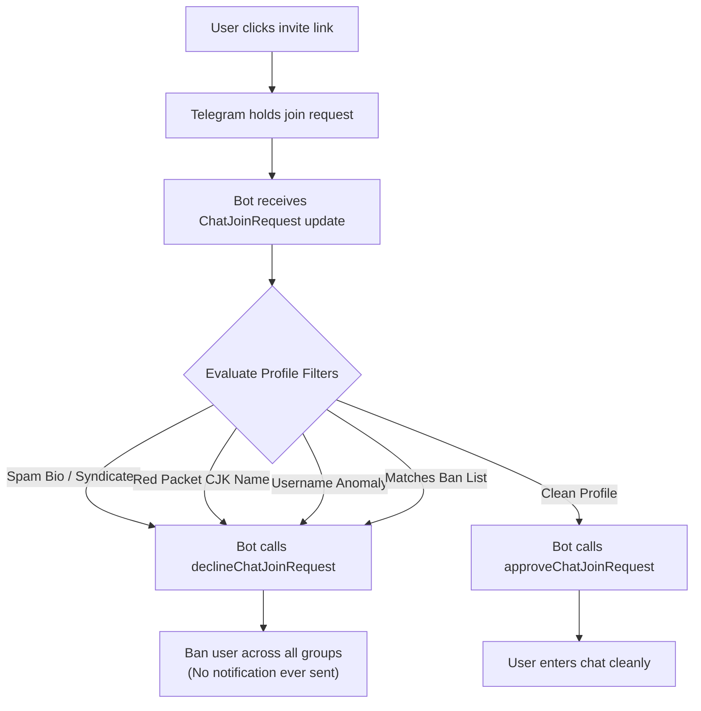

# Pre-Notification Moderation Analysis & Architectural Blueprint

## Problem Statement
In Telegram group chats, reactive moderation (detecting spam after message delivery and issuing `deleteMessage`) often fails to prevent client push notifications (APNs / FCM) and alert sounds/banners from disturbing group members. This document logs technical mechanisms and architectural designs to enforce moderation **before** notifications can trigger.

---

## 1. Telegram Architectural Constraints
- **No Inbound Pre-Delivery Proxy:** Telegram MTProto servers dispatch messages to group members and trigger push notifications concurrently with webhook / `getUpdates` delivery to bots.
- **Race Condition in Reactive Deletion:** Calling `deleteMessage` occurs after message distribution (~50ms–300ms delay). While modern iOS and Android Telegram clients attempt to retract notifications upon receiving deletion updates, notifications have frequently already buzzed, chimed, or been recorded in device notification logs.
- **Rule of Thumb:** A message delivered to a member's chat client *will* trigger a notification if notifications are active. Therefore, **moderation before notification requires preventing message or join event generation in the first place**.

---

## 2. Solution for Joining Messages: Chat Join Requests (`chat_join_request`)

### Mechanism
- Enable **"Request Admin Approval" / "Approve New Members"** on group invite links or public supergroup links.
- When an invite link with approval required is used:
  1. The user **does not join** the group immediately.
  2. **No `new_chat_members` service message** is generated.
  3. **Zero push notifications** are delivered to group members.
  4. Telegram delivers an update to the bot with the field `chat_join_request`.

### Inspection & Decision Flow

### Gogcbot Current State & Required Work
- **Subscribed Update:** Subscribed in `pkg/bot/bot.go` (`"chat_join_request"`).
- **Current Handler:** `pkg/bot/handlers.go` (inside `handleUpdate`) logs the event and saves the group, but does not inspect or call approval/decline APIs.
- **Required Library Calls:**
  - `tgbotapi.ApproveChatJoinRequestConfig{ChatConfig: tgbotapi.ChatConfig{ChatID: ...}, UserID: ...}`
  - `tgbotapi.DeclineChatJoinRequest{ChatConfig: tgbotapi.ChatConfig{ChatID: ...}, UserID: ...}`
- **Admin Permission Requirement:** Bot must have the `can_invite_users` administrator privilege in the group.

---

## 3. Solution for In-Chat Spam Messages: Default Permission Quarantine

### Mechanism
- Restrict default group permissions via `setChatPermissions`:
  - Set default permissions for standard members: **`can_send_messages = false`** (or restrict links/media).
- New joining accounts are in a **muted quarantine state** upon entry.
- If an automated spam script or raid bot tries to send messages, Telegram's client or server blocks the message (`CHAT_RESTRICTED`) without broadcasting it to other members.

### Verification Gate Flow
1. **Quarantine:** User enters group with `can_send_messages = false`.
2. **Challenge / Captcha:** Bot prompts user (via Direct Message, WebApp, or captcha service like Shieldy).
3. **Approval:** Upon passing captcha/reputation check, bot executes `restrictChatMember` to grant `can_send_messages = true`.
4. **Result:** Untrusted/spammer accounts can never trigger message push notifications for group members.

---

## 4. Native Telegram Supergroup Features

1. **Aggressive Anti-Spam (Supergroups > 200 members):**
   - Telegram's internal machine learning filter operates directly on Telegram server clusters.
   - Deletes automated spam at the edge before client push notification delivery completes.
2. **Forum Topics (Hide General Topic):**
   - Groups configured as forums can route system messages and captcha verifications to a dedicated Welcome/General topic.
   - Members can mute this topic or admins can hide the General topic, eliminating noise.
3. **Hide Members (Groups > 100 members):**
   - Prevents spammers from scraping user lists for mass mention tags or DM harassment.
